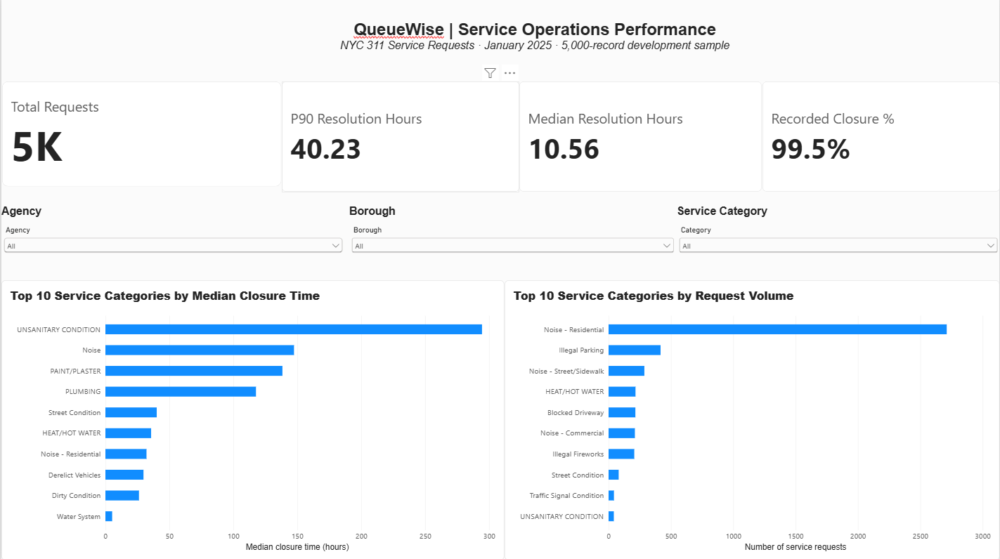

# QueueWise — Service Operations Intelligence

An end-to-end business analytics portfolio project
investigating service request volume, recorded closure
durations, and operational performance patterns.

## Live Application

[Launch QueueWise Interactive Dashboard] (https://queuewise-service-analytics-dznxkp4taup8ktjcg7pjjl.streamlit.app/)

## Business Problem

How can operations managers identify service categories
with high workloads or unusually long closure durations
and prioritise further investigation?

## Technical Architecture

NYC Open Data API
→ Python Data Extraction
→ Validation and Transformation
→ DuckDB / SQL Analysis
→ Power BI and Streamlit
→ Business Recommendations

## Technologies

- Python, pandas
- SQL, DuckDB
- Power BI, DAX
- Streamlit, Plotly
- REST API extraction
- Git, GitHub, pytest

## Features

- Dynamic operational KPI reporting
- Category-level performance comparisons
- Agency, borough and category filtering
- Downloadable analytical summaries
- Reproducible data extraction

## Dashboard Preview

## Business Documentation

- [Business Case](docs/business_case.md)
- [Business Requirements](docs/requirements.md)
- [Executive Findings](docs/executive_findings.md)

## Data

Source: NYC Open Data — 311 Service Requests

The Power BI development sample and Streamlit daily
cohort use different extraction windows. Their results
should not be directly compared.

## Limitations

This is an independent portfolio case study.
The results do not represent official NYC operational
performance assessments.

## Running Locally

pip install -r requirements.txt

python scripts/fetch_demo_data.py

streamlit run app/streamlit_app.py